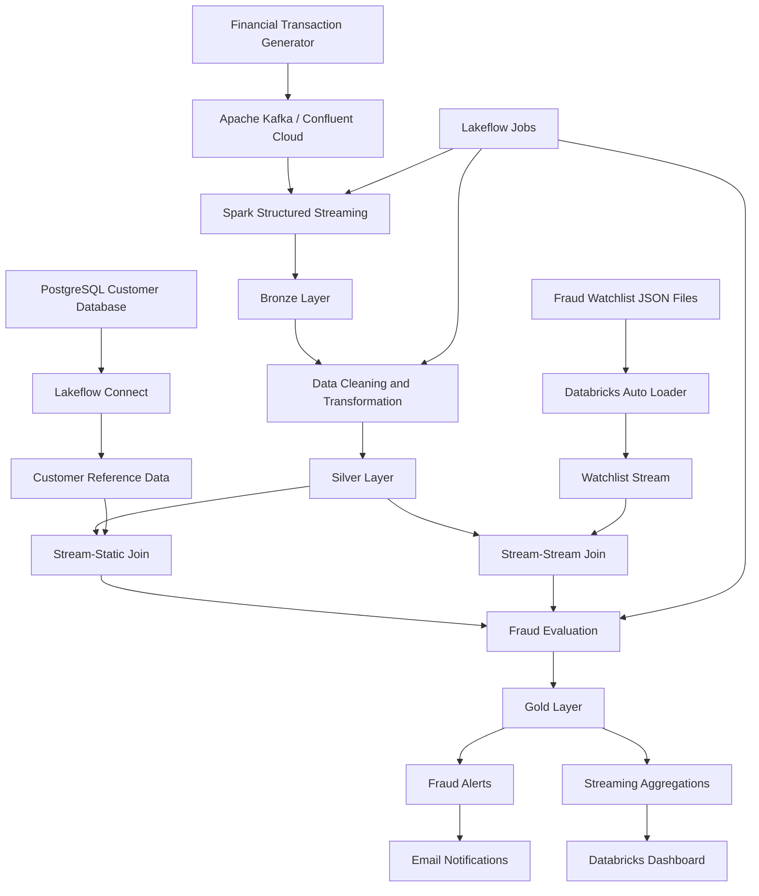

# 🚀 FraudFlux1
### Real-Time Financial Fraud Detection & Streaming Data Engineering Pipeline

**Stream. Detect. Protect.**

FraudFlux1 is an end-to-end real-time financial fraud detection and data engineering project built using modern streaming technologies. The project demonstrates how continuously arriving financial transaction data can be ingested, processed, enriched, and monitored using Apache Kafka, Apache Spark Structured Streaming, and the Databricks Lakehouse Platform.

The pipeline integrates transaction streams, customer reference information, and fraud watchlist data to demonstrate real-time fraud monitoring through distributed data processing, streaming joins, automated alerts, and analytical dashboards.

---

## 📌 Table of Contents

1. Project Overview
2. Problem Statement
3. Project Objectives
4. Technology Stack
5. System Architecture
6. End-to-End Pipeline Workflow
7. Medallion Architecture
8. Core Data Engineering Concepts
9. Fraud Detection Logic
10. Project Features
11. Repository Structure
12. Prerequisites
13. Setup and Configuration
14. Pipeline Execution Workflow
15. Security Considerations
16. Learning Outcomes
17. STAR Framework – Project Demonstration
18. SBI Framework – Project Impact
19. Future Enhancements
20. References and Acknowledgements

---

## 1. Project Overview

Financial institutions process thousands of transactions across digital payment systems, banking applications, and financial platforms.

Identifying suspicious transactions requires the ability to process incoming events continuously, integrate customer information, and evaluate transaction patterns efficiently.

FraudFlux1 demonstrates a streaming-based approach to this challenge by combining multiple data sources into a unified data processing architecture.

The system demonstrates:

- Continuous financial transaction ingestion using Apache Kafka.
- Distributed stream processing using PySpark.
- Customer information integration using PostgreSQL.
- Incremental file ingestion using Databricks Auto Loader.
- Real-time transaction enrichment using streaming joins.
- Fraud watchlist correlation.
- Time-based streaming aggregations.
- Automated email notifications.
- Near-real-time dashboard monitoring.
- Workflow orchestration using Databricks Lakeflow Jobs.

## 2. Problem Statement

Traditional batch-oriented data processing systems may introduce delays between transaction generation and fraud monitoring.

Financial transaction monitoring requires a data processing architecture capable of handling continuously arriving events while integrating customer information and changing fraud intelligence.

The major challenges include:

- Processing high-volume transaction streams.
- Integrating structured and semi-structured data.
- Enriching transactions with customer reference information.
- Identifying suspicious transaction patterns.
- Matching incoming transactions against fraud watchlists.
- Handling late-arriving events.
- Generating timely fraud alerts.
- Supporting continuous analytical monitoring.

**Proposed solution:** Build a real-time streaming data pipeline using Apache Kafka, Spark Structured Streaming, PostgreSQL, and Databricks to demonstrate transaction ingestion, transformation, enrichment, fraud monitoring, and reporting.

## 3. Project Objectives

The primary objectives are:

1. Understand event-driven data ingestion using Apache Kafka.
2. Implement continuous data processing using Spark Structured Streaming.
3. Integrate transactional and reference datasets.
4. Apply Bronze, Silver, and Gold data architecture.
5. Perform stream-static and stream-stream joins.
6. Understand event-time processing and watermarking.
7. Implement window-based streaming aggregations.
8. Demonstrate automated fraud notifications.
9. Develop a monitoring dashboard.
10. Understand workflow orchestration in modern data engineering systems.

## 4. Technology Stack

| Technology | Purpose |
|---|---|
| Python | Transaction generation and supporting logic |
| Apache Kafka | Real-time event ingestion |
| Confluent Cloud | Managed Kafka streaming platform |
| Apache Spark | Distributed data processing |
| PySpark | Python-based Spark transformations |
| Spark Structured Streaming | Continuous stream processing |
| Databricks | Lakehouse and data engineering platform |
| PostgreSQL | Customer reference data storage |
| Lakeflow Connect | PostgreSQL data ingestion |
| Lakeflow Spark Declarative Pipelines | Managed data pipeline development |
| Databricks Auto Loader | Incremental file ingestion |
| Delta Lake | Reliable lakehouse storage |
| SQL | Data querying and transformation |
| SMTP | Email-based fraud notifications |
| Databricks Lakeflow Jobs | Workflow orchestration |
| Databricks Dashboards | Data visualization and monitoring |

## 5. System Architecture

FraudFlux1 demonstrates a multi-source streaming data architecture.

### High-Level Architecture



### Architecture Explanation

The architecture consists of three major data ingestion paths:

**1. Transaction Streaming**

Financial transaction events are generated using Python and published to Kafka topics. Spark Structured Streaming consumes these events for continuous processing.

**2. Customer Reference Data**

Customer information is maintained in PostgreSQL and integrated into Databricks through Lakeflow Connect.

**3. Fraud Watchlist Ingestion**

Fraud watchlist information is provided through JSON files and ingested incrementally using Databricks Auto Loader.

These data sources are integrated through streaming transformations and joins to support fraud evaluation and monitoring.

## 6. End-to-End Pipeline Workflow

### Stage 1 – Transaction Data Generation

A Python-based producer generates financial transaction events and publishes them to Kafka.

Example transaction structure:

```json
{
  "transaction_id": "TXN10001",
  "customer_id": "CUST101",
  "transaction_amount": 8500,
  "transaction_type": "ONLINE",
  "transaction_timestamp": "2026-11-17T10:30:00"
}
```

The example represents an illustrative transaction record, not an actual production transaction.

### Stage 2 – Kafka-Based Data Ingestion

Apache Kafka acts as the distributed event-streaming platform.

Key concepts:

- Producers
- Consumers
- Topics
- Partitions
- Offsets
- Event serialization

Kafka decouples transaction generation from downstream processing.

### Stage 3 – Spark Structured Streaming

Spark Structured Streaming consumes transaction events from Kafka.

The incoming data is processed using streaming DataFrames and prepared for subsequent transformations.

Key processing concepts include:

- Streaming DataFrames
- Kafka source integration
- Continuous event ingestion
- Checkpointing
- Incremental processing

### Stage 4 – Bronze Layer

The Bronze layer stores incoming source data in its raw or minimally processed form.

Purpose:

- Preserve source information.
- Maintain an initial landing layer.
- Support downstream transformations.
- Separate ingestion from business processing.

### Stage 5 – Silver Layer

The Silver layer focuses on data cleaning and transformation.

Typical processing activities include:

- Parsing JSON records.
- Handling missing values.
- Applying data types.
- Standardizing transaction attributes.
- Preparing customer and watchlist datasets.
- Validating incoming records.

### Stage 6 – Customer Data Integration

Customer reference data is maintained in PostgreSQL.

Lakeflow Connect is used to bring relational customer data into the Databricks environment.

The customer information can then be used to enrich incoming financial transactions.

### Stage 7 – Stream-Static Join

A stream-static join combines continuously arriving transaction events with customer reference data.

This enables transaction evaluation using customer-related information, such as configured transaction limits.

Illustrative business rule:

```python
if transaction_amount > customer_transaction_limit:
    transaction_status = "FLAGGED"
else:
    transaction_status = "NORMAL"
```

### Stage 8 – Fraud Watchlist Integration

The fraud watchlist is provided through JSON files.

Databricks Auto Loader incrementally discovers and ingests incoming files.

This creates a continuously updated dataset that can be used to correlate transactions with watchlist information.

### Stage 9 – Stream-Stream Join

A stream-stream join combines two continuously changing datasets.

In this project, transaction events are correlated with fraud watchlist events.

This demonstrates:

- Event correlation.
- Streaming state management.
- Event-time constraints.
- Watermark-based processing.
- Fraud-related event matching.

### Stage 10 – Watermarks and Stateful Processing

Streaming applications must handle records that arrive later than expected.

Watermarks help manage late-arriving events and control state retention for supported streaming operations.

**Stateless processing:** Processes records independently without retaining previous processing state.

**Stateful processing:** Maintains information across events to support joins and aggregations.

### Stage 11 – Window-Based Aggregations

Window-based aggregation summarizes continuously arriving transaction data over defined time intervals.

Potential analytical measures include:

- Transaction counts.
- Transaction volumes.
- Time-based activity patterns.
- Aggregated transaction information.

### Stage 12 – Fraud Alerts

The project demonstrates email-based fraud notifications using SMTP.

The notification workflow is intended to communicate suspicious transaction events to relevant recipients.

### Stage 13 – Dashboard Monitoring

Databricks Dashboards provide a visualization layer for processed transaction information.

The dashboard supports operational monitoring and analytical exploration of streaming results.

### Stage 14 – Workflow Orchestration

Databricks Lakeflow Jobs coordinates the execution of different pipeline components.

Orchestration helps organize dependencies between ingestion, transformation, fraud evaluation, and reporting.

## 7. Medallion Architecture

FraudFlux1 demonstrates the Medallion Architecture, which organizes data into three logical layers.

| Layer | Description | Purpose |
|---|---|---|
| Bronze | Raw source data | Initial data ingestion |
| Silver | Cleaned and transformed data | Data quality and enrichment |
| Gold | Business-ready datasets | Fraud monitoring and analytics |

### Bronze Layer

- Ingest transaction streams.
- Preserve source records.
- Capture incoming watchlist information.

### Silver Layer

- Clean and standardize records.
- Transform transaction attributes.
- Integrate customer information.
- Prepare data for fraud evaluation.

### Gold Layer

- Produce processed fraud-related datasets.
- Support analytical aggregations.
- Provide information for alerts and dashboards.

## 8. Core Data Engineering Concepts

| Concept | What it demonstrates |
|---|---|
| Event-Driven Architecture | Continuous event ingestion |
| Apache Kafka | Distributed messaging |
| Spark Structured Streaming | Real-time processing |
| Checkpointing | Streaming progress and recovery |
| Auto Loader | Incremental file ingestion |
| Stream-Static Join | Combining streams with reference data |
| Stream-Stream Join | Correlating multiple event streams |
| Watermarking | Managing late-arriving events |
| Stateful Processing | Maintaining streaming state |
| Window Aggregation | Time-based data summarization |
| Medallion Architecture | Layered data organization |
| Lakehouse | Unified data storage and processing |
| Orchestration | Coordinating pipeline execution |

## 9. Fraud Detection Logic

The project demonstrates fraud-related monitoring through transaction enrichment and watchlist correlation.

Two important processing approaches are demonstrated:

**Customer-based evaluation**

Transactions can be evaluated against customer-related attributes and configured transaction limits.

**Watchlist-based evaluation**

Transaction events can be correlated with fraud watchlist information to identify potential matches.

These approaches demonstrate rule-based fraud monitoring concepts.

The project is an educational demonstration and should not be considered a production-ready financial fraud prevention system.

## 10. Key Features

- Real-time financial transaction ingestion.
- Kafka-based event streaming.
- Distributed processing using PySpark.
- Integration of PostgreSQL customer information.
- Incremental JSON ingestion using Auto Loader.
- Bronze, Silver, and Gold data organization.
- Stream-static and stream-stream joins.
- Event-time processing and watermarking.
- Window-based streaming aggregations.
- Email-based fraud notifications.
- Near-real-time dashboard monitoring.
- Workflow orchestration using Lakeflow Jobs.

## 11. Repository Structure

The following is a suggested documentation structure. Adjust directory names to match the actual files in this repository.

```text
FraudFlux1/
│
├── dashboard/
│   └── Dashboard resources
│
├── kafka_producer/
│   └── Transaction producer scripts
│
├── postgres_sql/
│   └── Database setup and SQL scripts
│
├── databricks/
│   ├── notebooks/
│   ├── pipelines/
│   └── streaming/
│
├── fraud_watchlist/
│   └── Watchlist generation resources
│
├── README.md
│
└── .gitignore
```

## 12. Prerequisites

Before running the complete project, the following are required:

- Python environment.
- Apache Kafka or Confluent Cloud access.
- Databricks workspace with the required features.
- PostgreSQL database.
- Appropriate Kafka and database credentials.
- SMTP configuration for email notifications.
- Access permissions for required cloud and data services.

Some services and capabilities may require account setup or a suitable Databricks environment.

## 13. Setup and Configuration

### Step 1 – Clone the repository

```bash
git clone https://github.com/YOUR_USERNAME/FraudFlux1.git

cd FraudFlux1
```

### Step 2 – Set up Python

```bash
python -m venv .venv
```

Activate the environment on Windows:

```powershell
.venv\Scripts\activate
```

### Step 3 – Install dependencies

Install the packages required by the actual producer scripts and supporting Python modules.

For example:

```bash
pip install kafka-python
```

Additional packages depend on the implementation.

### Step 4 – Configure Kafka

- Create or access a Kafka cluster.
- Configure the transaction topic.
- Obtain the required connection details.
- Configure producer authentication securely.

### Step 5 – Configure PostgreSQL

- Create the required database.
- Prepare the customer reference tables.
- Configure the database connection.
- Verify access from the Databricks environment.

### Step 6 – Configure Databricks

- Open your Databricks workspace.
- Configure the required data sources.
- Set up secure credentials.
- Import the notebooks and pipeline resources.
- Configure the necessary catalog and storage permissions.

### Step 7 – Execute the Pipeline

Follow the source project's execution dependencies to run ingestion, transformation, fraud evaluation, and reporting components.

**Note:** These are setup guidelines. Exact commands, workspace configurations, and notebook execution order must follow the supplied implementation and your environment.

## 14. Security Considerations

Security is important when working with financial data and cloud services.

- Never upload passwords or API keys to GitHub.
- Use environment variables or secure secret-management facilities.
- Avoid committing `.env` files.
- Use synthetic or authorized datasets.
- Protect database credentials.
- Configure appropriate access permissions.
- Avoid exposing sensitive transaction information.

## 15. Learning Outcomes

Through this project, the following Data Engineering concepts can be explored:

1. Understanding distributed event-streaming architecture.
2. Working with Kafka producers and topics.
3. Processing streaming data using Spark.
4. Integrating relational databases with streaming systems.
5. Understanding ETL and data transformation workflows.
6. Applying the Medallion Architecture.
7. Performing streaming joins.
8. Understanding watermarks and event-time processing.
9. Implementing window-based aggregations.
10. Understanding data pipeline orchestration.
11. Connecting processed data to analytical dashboards.
12. Understanding the fundamentals of real-time data engineering systems.

## 16. STAR Framework – Project Demonstration

### Situation

Financial transaction monitoring requires continuous processing of incoming transactions and integration with customer information and fraud watchlists.

### Task

Understand and implement an end-to-end streaming data engineering workflow capable of ingesting, transforming, enriching, and evaluating financial transaction events.

### Action

Worked through a streaming architecture involving Python, Apache Kafka, Spark Structured Streaming, PostgreSQL, Databricks, streaming joins, and automated monitoring workflows.

### Result

Demonstrated an integrated streaming data processing architecture that supports transaction enrichment, fraud-related event evaluation, and analytical monitoring.

*Add your own verified implementation results, testing evidence, and performance measurements here.*

## 17. SBI Framework – Project Impact

**Situation:** Financial transaction monitoring requires timely processing of continuously generated transaction data.

**Behavior:** The project demonstrates the integration of Kafka, Spark Structured Streaming, reference datasets, streaming joins, and automated notification workflows.

**Impact:** The architecture provides a practical demonstration of how streaming data engineering concepts can support fraud monitoring and operational analytics.

## 18. Future Enhancements

Potential improvements include:

- Developing configurable fraud detection rules.
- Adding automated data quality validation.
- Implementing schema evolution handling.
- Adding pipeline performance monitoring.
- Developing transaction anomaly detection.
- Adding unit testing for transformation logic.
- Implementing CI/CD for pipeline deployment.
- Improving dashboard monitoring.
- Adding additional transaction risk indicators.

These are proposed enhancements and are not claimed as existing functionality.

## 19. References and Acknowledgements

This project is an educational adaptation based on the following tutorial:

**Original Project:** FinGuard – End-to-End Spark Streaming Project

**Creator:** Narender Kumar – DataBeli

**YouTube Tutorial:**

https://youtu.be/SsE5ZfxtiOI

**Original Repository:**

https://github.com/databeli/finguard_streaming_project

The original creator deserves credit for the tutorial, architecture, instructional materials, and source implementation.

FraudFlux1 is the repository name used for this learning and portfolio adaptation. Independent modifications and additional contributions should be documented separately.

Please review the original repository's license and attribution requirements before redistribution.

---

## 20. Conclusion

FraudFlux1 demonstrates the application of modern Data Engineering technologies to a real-time financial transaction monitoring use case.

By combining Apache Kafka, Spark Structured Streaming, PySpark, PostgreSQL, and the Databricks Lakehouse Platform, the project provides exposure to distributed data processing, streaming ingestion, data transformation, event correlation, and workflow orchestration.

The project serves as a practical learning experience in designing and understanding scalable data pipelines for real-world analytical applications.

**FraudFlux1 — Stream. Detect. Protect.**
